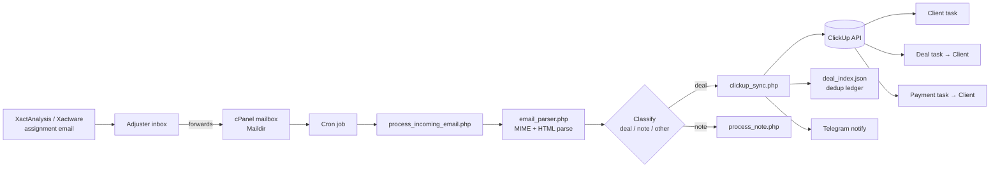

# XactAnalysis → ClickUp CRM Automation

Automatically turns **insurance restoration assignment emails into structured
ClickUp CRM records** — no manual data entry.

A restoration contractor receives job assignments from **XactAnalysis**
(Xactware / Verisk's claims platform). This tool reads each assignment email,
extracts the business-relevant fields, and creates three **linked** ClickUp
tasks via the ClickUp API:

1. **Client** — created first, named after the insured customer.
2. **Deal** — named `Insured Name | ClaimID`, linked back to the Client.
3. **Payment** — named `Insured Name | ClaimID`, linked back to the Client.

Follow-up emails are detected as **notes** and attached to the existing deal
instead of creating new records. The whole pipeline runs unattended on a cron
job, and can post a Telegram notification whenever a new deal lands.

> **Portfolio note:** this is a sanitized version of a system built for a real,
> delivered project. **No credentials are included** — `config.sample.php` only
> has empty placeholders for you to fill with your own tokens. The production
> mailbox and all client records have been removed, and everything in
> `samples/` is fictitious.

---

## The pipeline



**How an email travels:**

1. **Origin — XactAnalysis (xactware.com).** The insurer's platform emails a new
   assignment (`Subject: Contact <NAME> @ (<Type of Loss>) - <Company> (Normal
   assignment)`) to the contractor/adjuster.
2. **Forward.** The adjuster forwards it to a dedicated cPanel mailbox
   (e.g. `clickupapi@yourdomain.com`). Forwarding is preserved, so the parser
   reads the inner forwarded message.
3. **Cron.** A scheduled job runs `process_incoming_email.php` against new
   messages in the mailbox's Maildir.
4. **Parse.** `email_parser.php` decodes the MIME body (`text/plain`,
   `quoted-printable` or `base64`, with an HTML-table fallback) and extracts the
   `Assignment Profile` fields.
5. **Classify & sync.** Deals go to `clickup_sync.php`; notes go to
   `process_note.php`. `deal_index.json` prevents duplicates; `telegram.php`
   notifies.

### Fields extracted

`Claim Number` · `Insured Name` · `Mobile Phone` · `Email Address` ·
`Type of Loss` · `Date of Loss` · `XA ID` · `Location of Property` ·
the XactAnalysis assignment link · and the insurance carrier (detected from the
`From:` / subject line).

---

## Features

- **Raw MIME email parsing** — multipart, `quoted-printable`, `base64`, plus an
  HTML-table fallback for `<tr><td>Label</td><td>Value</td></tr>` layouts.
- **Forwarded-message aware** — reads the inner XactAnalysis message inside an
  adjuster's forward.
- **ClickUp API integration** — creates tasks with custom fields and custom task
  types, and links Client ↔ Deal ↔ Payment.
- **Idempotent** — a per-claim ledger (`deal_index.json`) prevents duplicate
  tasks when the same email is re-processed.
- **Deal / note / other classification** so follow-ups update the right record.
- Optional **Telegram** notifications.
- **Credentials isolated** in a git-ignored `config.php`.

## Tech stack

PHP 8 · ClickUp REST API · cURL · MIME / email parsing · JSON · Telegram Bot API · cron

---

## Setup

```bash
# 1. Copy the sample config and fill in YOUR OWN credentials
cp config.sample.php config.php
```

Then edit `config.php`:

| Key | Where to get it |
|-----|-----------------|
| `clickup_token` | ClickUp → Settings → Apps → API Token (`pk_…`) |
| `clickup_list_id` | Your Workspace/Team ID (the number in `app.clickup.com/{id}/…`) |
| `telegramBotToken` / `telegramChatId` | From @BotFather (optional) |
| `db_*` | Your MySQL connection (optional) |

Finally, point the `list_id` values in `filds.js` / `filds_fills.js` at your own
ClickUp list IDs. Run `php get_all_filds.php` to inspect a list's custom fields
and their IDs.

> `config.php`, `Emails/` and `deal_index.json` are git-ignored, so your real
> tokens and any client data never get committed.

## Quick try (no ClickUp account needed)

Parse the fictitious sample assignment and preview the extracted fields:

```bash
php -r 'require "email_parser.php";
        print_r(parseXactAnalysisEmail("samples/sample_assignment.eml"));'
```

Expected output: `Claim Number`, `Insured Name`, `Type of Loss`, etc. parsed
from `samples/sample_assignment.eml`.

## Run against your own ClickUp

```bash
# End-to-end: read the fill template, create linked tasks in your workspace
php filing_sample_1.php
```

## Run on a schedule (production)

Point a cron job at the mailbox so new forwards are processed automatically:

```cron
# every 5 minutes
*/5 * * * * /usr/bin/php /home/USER/clickup/process_incoming_email.php >> /home/USER/clickup/cron.log 2>&1
```

`process_incoming_email.php` scans the mailbox's Maildir for new messages,
parses each one, and syncs it to ClickUp.

---

## Files

| File | Purpose |
|------|---------|
| `process_incoming_email.php` | Cron entry point — scans the mailbox for new messages |
| `email_parser.php` | Decode MIME email, handle forwards, extract & classify fields |
| `clickup_sync.php` | Create linked Client / Deal / Payment tasks via ClickUp API |
| `process_email.php` / `process_note.php` | Deal vs. note handling |
| `deal_index.php` | Read/write the dedup ledger |
| `get_all_filds.php` | Inspect a ClickUp list's custom fields |
| `telegram.php` | Send a Telegram notification |
| `filds.js` / `filds_fills.js` | ClickUp field map + fill template |
| `config.sample.php` | Credential template — copy to `config.php` |
| `samples/` | Fictitious sample email + empty ledger |

## License

MIT
