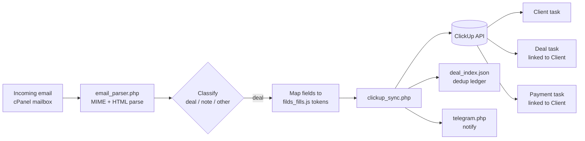

# Email → ClickUp CRM Automation

Turns incoming **assignment / lead emails into structured ClickUp CRM records**, with zero manual data entry.

When a new job notification email arrives (in this case XactAnalysis insurance
restoration assignments delivered to a cPanel mailbox), this tool parses the raw
MIME email, extracts the business-relevant fields, and creates three **linked**
ClickUp tasks via the ClickUp API:

1. **Client** — created first, named after the customer.
2. **Deal** — named `Client Name | ClaimID`, linked back to the Client.
3. **Payment** — named `Client Name | ClaimID`, linked back to the Client.

It de-duplicates against existing records, so re-processing the same email never
creates duplicates, and it can send a Telegram notification when a new deal lands.

> **Portfolio note:** this is a sanitized version of a system I built for a real
> client. All credentials have been removed and all sample data (`samples/`) is
> fictitious. The production mailbox and client records are not included.

---

## How it works



1. **Parse** — `email_parser.php` decodes the `text/plain` (or `quoted-printable`
   / `base64`) part of a raw MIME email and pulls out labelled fields such as
   `Claim Number`, `Insured Name`, `Mobile Phone`, `Type of Loss`,
   `Location of Property`, plus the assignment link and insurance carrier.
2. **Classify** — each email is tagged `deal`, `note`, or `other` so that only
   real assignments create deals.
3. **Fill** — extracted values replace the `[[placeholder]]` tokens in the
   ClickUp field map (`filds.js` / `filds_fills.js`).
4. **Sync** — `clickup_sync.php` creates the linked Client / Deal / Payment
   tasks through the ClickUp API, matching custom task types and custom fields.
5. **Dedup & notify** — `deal_index.json` records what was already created;
   `telegram.php` posts a notification.

---

## Features

- Raw **MIME email parsing** — multipart, `quoted-printable` and `base64` bodies,
  plus an HTML-table fallback for sources that send `<tr><td>Label</td>…</tr>`.
- **ClickUp API integration** — task creation, custom fields, custom task types,
  and relationship links between tasks.
- **Idempotent** — a per-deal ledger prevents duplicate Client/Deal/Payment tasks.
- **Carrier detection** from the subject/body.
- Optional **Telegram** notifications.
- Credentials isolated in a git-ignored `config.php`.

## Tech stack

PHP 8 · ClickUp REST API · cURL · MIME parsing · JSON · Telegram Bot API

---

## Setup

```bash
# 1. Copy the sample config and fill in your own credentials
cp config.sample.php config.php

# 2. Edit config.php:
#    - clickup_token    (ClickUp → Settings → Apps → API Token)
#    - clickup_list_id  (your Workspace/Team ID)
#    - telegram tokens  (optional)

# 3. Point filds.js / filds_fills.js list_id values at your own
#    ClickUp list IDs (use get_all_filds.php to inspect your fields).
```

`config.php`, `Emails/` and `deal_index.json` are git-ignored so no real
credentials or client data are ever committed.

## Try it with the sample email

```bash
# Parse the fictitious sample assignment and preview the extracted fields
php -r 'require "email_parser.php";
        print_r(parseXactAnalysisEmail("samples/sample_assignment.eml"));'
```

To run an end-to-end sync into your own ClickUp workspace, fill in `config.php`
and run `php filing_sample_1.php`.

## Files

| File | Purpose |
|------|---------|
| `email_parser.php` | Decode MIME email and extract/classify fields |
| `clickup_sync.php` | Create linked Client/Deal/Payment tasks via ClickUp API |
| `process_incoming_email.php` | Entry point for a new mailbox message |
| `process_email.php` / `process_note.php` | Deal vs. note handling |
| `deal_index.php` | Read/write the dedup ledger |
| `get_all_filds.php` | Inspect a ClickUp list's custom fields |
| `telegram.php` | Send a Telegram notification |
| `filds.js` / `filds_fills.js` | ClickUp field map + fill template |
| `samples/` | Fictitious sample email and empty ledger |

## License

MIT
